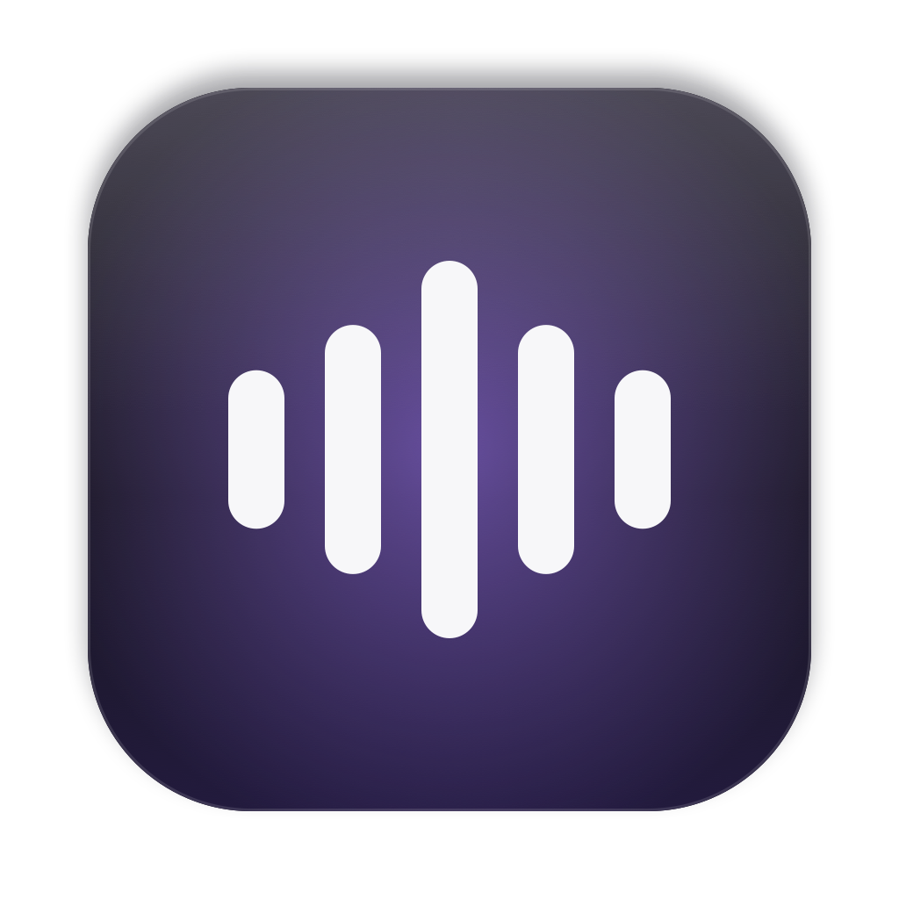

<div align="center">



# 指语 Zhiyu

**指哪说哪**

[English](README.md)


</div>

指语是 macOS 上的语音输入 App。鼠标指向哪个文本框，就把话说进哪个文本框。指语免费、开源（MIT），声音只在你的 Mac 上处理。

## 为什么做指语

作者同时用过三款工具，每款都缺一样东西。

- Handy 开源、快速、本地运行，但几乎没有 AI 润色。
- Typeless 能做 AI 润色，还能自动学习词典，但只能用云端，而且要付费。
- 豆包输入法文字出得快，之后会自己修正，但不能把字打进鼠标所在的文本框。

没有一款工具能在鼠标指向的文本框里直接听写。作者要的是三件事：快、准、通顺。指语只做这三件事。

## 亮点

- **指哪说哪。** 鼠标悬停在任意文本框上，按住热键说话，松开即可。文字进入鼠标所在的文本框，不需要先点击。
- **本地识别。** 默认模型是 Qwen3-ASR 0.6B 4-bit（MLX），支持中英混说并自动加标点。在 M1 上每句约 0.6 秒，实际使用中从说完到上屏的中位数约 0.8 秒。
- **先出字，后润色。** 文字立即显示，润色版本在 1 到 3 秒后原位替换。这一步只在原生应用中生效。
- **会学习的词典。** 拼音模糊匹配能把同音误识别修正为词典里的词，例如把「子语」「直雨」修正为「指语」。指语还会从你的手动修改中学习。
- **不会乱改你的话。** 忠实度守卫会拒绝添加你没说过的英文词、丢掉否定词或数字、改动过多的润色结果。
- **按应用切换风格。** 聊天类应用用口语风格，邮件用正式风格，终端和 IDE 用技术风格，并保留命令和文件名。
- **语音编辑。** 选中文字后按住热键说出指令，例如「改得正式一点」或「翻译成英文」，结果原位替换。

## 工作原理

```text
按住热键（或用力按下触控板）
        │
        ▼
录音（Audio.swift）──► 本地语音识别（asr_server.py，MLX，127.0.0.1:8776）
        │
        ▼
拼音模糊词典修正（phonetic.py）
        │
        ├─► 原生应用：先显示文字，润色完成后原位替换（校验通过才替换）
        │
        └─► 终端、浏览器、Electron 应用：最多等待 1.2 秒取得润色结果，然后只输入一次
```

## 功能

### 听写

- **按住说话：** 按住热键说话，松开后输入。默认热键是右 Option。可以改为任意按键或修饰键，推荐使用 F 键。
- **双击免手持：** 双击热键保持录音，再按一次停止。
- **说「发送」：** 句末说「发送」「回车」「发出去」或「send it」，指语自动按下回车。指语会排除「我想发送邮件」这类句子。

### 润色

指语提供三种润色模式：

| 模式 | 运行位置 | 说明 |
|---|---|---|
| 极速 | 本机规则 | 立即完成 |
| 智能 | 云端大模型 | 可接任意 OpenAI 兼容服务商 |
| 本地精修 | 本机 Qwen3 4B | 约 3 秒 |

三种模式都会去掉「呃」「嗯」「um」「uh」，修正标点和同音字。你在句中自我更正时，指语只保留更正后的版本。

### 词典与学习

- 拼音模糊修正只改词典里的词，不改其他真实词语。处理 300 个字符、300 个词条约需 27 毫秒。
- 指语从三处学习：你在文本框中的手动修改（会在 8 秒和 45 秒时重新读取文本框）、你在 Claude Code 里提交的内容（`~/.claude/history.jsonl`），以及可选的 AI 审阅。
- 同一个修正要出现两次，指语才会使用它。
- 在「词典」页删除的词条不会被重新学回来。

### 界面

- 支持 macOS 26 和 27 的 Liquid Glass 设计。
- 横向窗口，侧边栏包含「概览」「设置」「模型」「词典」「历史」五页。
- 「历史」页支持搜索和复制。
- 「概览」页显示每一步在哪里运行。

### 模型

- 「模型」页可以一键下载并启用经过测试的语音模型和本地润色模型。
- 可以选择中国镜像（hf-mirror.com）下载。
- 可以导入自己的 MLX 模型（来自 Hugging Face 仓库或本地文件夹）。
- 下载或导入失败的模型不会替换正在使用的模型。

### 云端润色

- 内置预设：DeepSeek、OpenAI、OpenRouter、SiliconFlow、阿里百炼、Ollama，也可以填写任意 OpenAI 兼容地址。
- API Key 存放在 macOS 钥匙串中。
- 「测试连接」按钮可以检查配置是否可用。
- 需要自定义请求头时，在 `config.json` 中填写 `llm_headers`。
- 推理型模型可能把输出额度全部用在"思考"上。DeepSeek 的地址会自动关闭思考模式。其他支持该字段的网关，可在 `config.json` 中设置 `"llm_disable_thinking": true`。

### 麦克风

- 显示当前麦克风：内置、有线耳机或蓝牙。
- 插拔耳机时，指语会重建音频链路。
- 戴蓝牙耳机时，指语默认用 Mac 内置麦克风录音，耳机只放声音。设置页的「戴蓝牙耳机时用 Mac 麦克风」可以关掉这个行为。合上屏幕时，内置麦克风不可用，指语改用耳机麦克风。
- 提示音「叮」在收到真实声音后才响。听到「叮」再说话，开头不会丢字。
- 「嘈杂环境模式」默认关闭，需要手动打开。该模式失败时会自动回退。

### 安全与可靠性

- 指语不会向密码框输入文字。
- 安全输入（Secure Input）阻止热键时，指语会给出警告。
- 录音失败时，音频保存到 `~/.config/zhiyu/failed`，不会丢失。

## 隐私

- 声音不离开你的 Mac。
- 只有文本会发送到云端大模型，并且需要满足两个条件：你配置了云端服务，且没有开启离线模式。
- API Key 存放在钥匙串中。
- 所有数据保存在 `~/.config/zhiyu`。

## 安装

环境要求：

- Apple Silicon 芯片的 Mac，macOS 15 或更高版本
- Xcode 命令行工具（提供 `swiftc`）
- Python 3.12
- [uv](https://docs.astral.sh/uv/)

从源码安装：

```bash
git clone <this repository> ~/zhiyu
cd ~/zhiyu
uv venv --python 3.12 .venv
uv pip install --python .venv/bin/python -r requirements.txt
./build.sh            # builds, signs, installs /Applications/指语.app
open /Applications/指语.app
```

将 `<this repository>` 换成本仓库的地址。指语默认读取 `~/zhiyu` 下的项目目录。如需改为其他位置，设置环境变量 `ZHIYU_HOME`。

**可选：保留权限。** 在钥匙串访问中创建一个名为「Zhiyu Local Signing」的自签名代码签名证书（证书助理 → 创建证书 → 类型选「代码签名」）。`build.sh` 会自动使用该证书。没有该证书时，`build.sh` 使用临时签名，每次重新构建后 macOS 可能会再次要求授权。

## 第一次使用

1. 首次打开指语时，按提示授予「辅助功能」和「麦克风」权限。
2. 打开「模型」页，下载默认语音模型（约 0.7 GB）。
3. 把鼠标悬停在任意文本框上，按住右 Option，说话，松开。
4. 想免手持时，双击右 Option 开始录音，再按一次停止。

## 模型

下载列表（「模型」页内一键下载并启用）：

- Qwen3-ASR 系列（默认：Qwen3-ASR 0.6B 4-bit）
- SenseVoice Small（支持粤语）
- GLM-ASR Nano
- 本地润色模型 Qwen3-4B-Instruct

导入自己的模型，必须满足以下要求：

- 格式为 MLX：目录中包含 `config.json` 和 `*.safetensors` 文件。
- 不支持 GGUF、PyTorch 的 `.bin` 文件和 ONNX 格式。

## 对比

以下信息来自公开资料（2026 年 10 月）。竞品信息来自厂商页面和评测。表中「?」表示未确认。

| | 指语 | Typeless | Wispr Flow | Superwhisper | VoiceInk | Handy |
|---|---|---|---|---|---|---|
| 价格 | 免费（MIT） | 起价 $12/月 | 起价 $12/月 | 约 $85/年 | $25 一次性 | 免费 |
| 本地识别 | ✓ | ✗ | ✗ | ✓ | ✓ | ✓ |
| 鼠标指向处直接输入 | ✓ | ✗ | ✗ | ✗ | ✗ | ✗ |
| 文字出现后修正 | ✓（原生应用） | ✗ | ✗ | ✗ | ✗ | ✗ |
| 拼音模糊词典 | ✓ | ✗ | ✗ | ✗ | ✗ | ✗ |
| 从你的修改中学习 | ✓ | 部分 | ? | ✗ | ? | ✗ |
| 语音编辑选中文字 | ✓ | ✓ | ? | ? | ✓ | ✗ |
| 按应用切换风格 | ✓ | ✓ | 部分 | ✓ | ✓ | ✗ |
| 手机应用 | ✗ | ✓ | ✓ | ✓ | ✗ | ✗ |

## 我们是怎么做出来的

作者指挥 AI 编程助手（Claude）做规划和集成，多个小模型分别编写单个文件。每次改动在安装前都由主模型编译和测试。下面 6 个决定都来自实测，而不是猜测。每个决定都包含当时遇到的问题和后来的改法。

1. **不做降噪。** 在识别前使用 DeepFilterNet 降噪会让识别变差：干净音频上字符错误率上升 8.6%，5 dB 的嘈杂人声中从 22% 升到 41%。作者删掉了降噪。改为在房间非常嘈杂时使用防幻觉守卫，阻止模型无限重复输出。
2. **本地 4B 模型不用于实时润色。** 本地 4B 模型的中位耗时是 2.8 秒，云端约 1.3 秒，所以本地模型太慢。指语因此提供三种润色模式，并采用「先出字，后修正」的设计。本地 4B 模型只留在「本地精修」模式中。
3. **润色必须忠实于原话。** 一次云端润色把「Fable 5.1」改写成了「DeepSeek V4.1 Flash」，还删掉了半句话。现在忠实度守卫会拒绝任何添加英文词、丢掉否定词或数字、或改动过多的结果。
4. **不能验证的文字不修改。** 早期「先出字，后修正」用退格键删除旧文字。在 Claude Code 等终端应用中，很多按键被丢掉，文字还会重复。现在的规则是：不能验证的文字绝不编辑。原生应用通过辅助功能 API 做校验后的原位替换。终端、浏览器和 Electron 应用最多等待 1.2 秒取得润色结果，然后只输入一次。
5. **嘈杂环境模式默认关闭。** Mac 内置麦克风配合苹果的语音处理功能不够稳定。作者把「嘈杂环境模式」改为手动开启，并在失败时自动回退。
6. **戴蓝牙耳机时不用耳机麦克风。** 蓝牙耳机一开麦克风就切到通话模式：音乐变成低音质，AirPods 在通透和降噪之间来回切。实测（M1，AirPods）前 0.5–0.6 秒收到的全是静音。软件无法避免这次切换，所以指语改用内置麦克风，或者建议使用有线耳机。
7. **只列出实测可用的模型。** 「模型」页只提供在测试 Mac 上确实加载并转写成功的语音模型。

## 局限与路线图

**局限：**

- 只支持 macOS 和 Apple Silicon，没有 iPhone 应用。
- 方言支持取决于所选模型。SenseVoice 支持粤语，其他模型不保证支持方言。
- 「文字出现后修正」只在原生应用中生效，这是有意的设计。

**路线图：**

- iPhone 应用
- 文件转写
- 逐字实时预览

## 项目结构

| 路径 | 作用 |
|---|---|
| `Sources/main.swift` | 主流程 |
| `Sources/Trigger.swift` | 热键、触控板、免手持 |
| `Sources/AXTarget.swift` | 查找文本框、输入文字、校验后替换 |
| `Sources/Audio.swift` | 录音 |
| `Sources/Clients.swift` | 配置、润色、守卫 |
| `Sources/DeviceInfo.swift` | 麦克风信息 |
| `Sources/MainWindow.swift` 等界面文件 | `MainWindow`、`OverviewPane`、`SettingsPane`、`ModelsPane`、`DictionaryPane`、`HistoryPane` |
| `asr_server.py` | 本地 MLX 语音识别服务，监听 127.0.0.1:8776 |
| `phonetic.py` | 拼音修正 |
| `learner.py` | 词典学习 |
| `build.sh` | 构建、签名、安装 |
| `art/` | 图标生成器 |

## 致谢

- **Handy**（cjpais，MIT）：预录音、按住或切换录音、语气词规则的灵感来源。
- **CapsWriter-Offline**（HaujetZhao）：拼音热词匹配的思路来源。
- **mlx-audio**、**mlx-lm**：Apple MLX 社区项目。
- **模型**：Qwen3-ASR（阿里通义千问）、SenseVoice（FunAudioLLM）、GLM-ASR（智谱）、Qwen3-4B-Instruct。

## 许可

本项目以 MIT 许可证发布。
